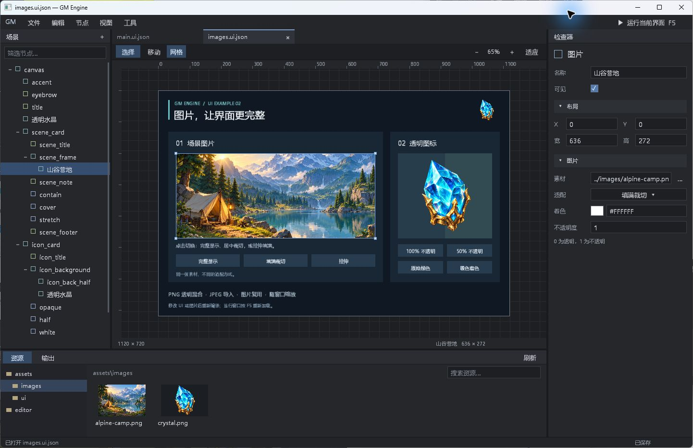

# 编辑器 v0.5 设计与操作依据

## 调研结论

参考 [Godot 的工作区、场景树、文件系统与检查器](https://docs.godotengine.org/en/stable/getting_started/introduction/first_look_at_the_editor.html)、[Unity 的窗口分工](https://docs.unity.com/en-us/engine/6000.3/manual/unity-editor/editor-windows-views-reference)、[Unity 工具栏](https://docs.unity.com/en-us/engine/6000.0/manual/unity-editor/editor-navigating-managing/toolbar) 和 [Unreal 编辑器界面](https://dev.epicgames.com/documentation/en-us/unreal-engine/unreal-editor-interface)。这些产品并不完全采用相同布局：Unreal 有保存快捷入口，Unity 有撤销历史入口。共同原则是区分全局命令、当前编辑工具、资源管理和对象属性。

GM 当前不需要照搬完整引擎的 3D、动画、服务和插件入口。保存、撤销已经在菜单和快捷键中，独立占一整排没有带来额外编辑能力。本版去掉这一排。

## 实际流程中发现的问题

| 操作 | 原有问题 | 本版设计 |
| --- | --- | --- |
| 编辑、保存、撤销 | 顶部大块空间重复显示菜单命令 | 文件/编辑菜单与 Ctrl+S、Ctrl+Z、Ctrl+Y；未保存标记留在文档标签 |
| 找到 PNG 并使用 | 文件树只列 UI；图片目录看起来为空 | 资源浏览器列 UI 和图片；选图片可预览并添加到画布或应用到选中图片节点 |
| 编辑多个资源 | 切换文件必须先处理未保存内容 | 文档标签保留各自文档、选择与撤销栈；切换不丢失编辑；关闭时处理未保存内容 |
| 添加/复制/删除节点 | 添加入口与场景位置分离，没有右键操作 | 场景面板的添加入口、节点右键菜单、Ctrl+D、Delete |
| 验证运行效果 | 需要另开终端编译再手动启动 | F5 编译当前内存文档并启动 Player；失败定位到输出，不强制保存源文件 |
| 调整画布 | 视口与全局工具混在一起 | 选择/移动/缩放/网格只出现在画布工具条；默认选择，避免随点击意外移动 |
| 编辑字段 | Tab 不能连续编辑，左右键不能移动文本光标 | 字段按顺序 Tab/Shift+Tab；光标、选择、复制/剪切/粘贴；Escape 取消 |
| 空闲编辑器 | 未操作仍持续拷贝文档和重绘 | 输入、文档变化、窗口变化才重绘；定时处理 CLI 邮箱和提示 |

## 空间安排

```text
文件  编辑  节点  视图  工具                       运行当前界面 F5
┌──────────────┬──────────────────────────────┬─────────────────┐
│ 场景         │ 文档标签                     │ 检查器          │
│ 筛选 / 添加  │ 选择、移动、网格、缩放       │                 │
│              │                              │ 节点：类型相关  │
│ 当前节点树   │            画布              │ 属性分组        │
│              │                              │                 │
├──────────────┴──────────────────────────────┤ 素材：预览、    │
│ 资源 / 输出                                │ 信息与使用操作  │
│ 文件夹                  UI / 图片资源      │                 │
└────────────────────────────────────────────┴─────────────────┘
资源路径 / 操作反馈                                   保存状态
```

左侧用于场景结构，底部用于项目素材，右侧根据选择显示属性。底部“资源”和“输出”共享空间，运行失败时切到输出。面板可拖动调整；视口始终保留最小宽度。所有界面动作仍调用已有文档命令或可发现的编辑器命令，不增加 Agent 专用界面。

## 范围

这次实现 UI 编辑所需的具体流程。没有实现任意浮动停靠、3D 模式、动画时间轴或插件系统；不为这些尚不存在的能力放置空按钮。性能实测和与其他引擎的差异另见运行时比较文档。

## 实现与验证



已实现上述工作区、最多 8 个文档标签、菜单/快捷键、节点右键菜单、图片缩略图与资源检查器。编辑器 F5 运行当前内存文档，F8 停止；编辑编辑器外壳的应用快捷键改为 Ctrl+Shift+F5，F6 仍可恢复默认外壳。标签切换保留各自未保存内容与撤销栈；关闭时提示处理修改。

实际窗口验证了图片目录浏览、PNG 预览、添加图片节点、Ctrl+Z、文本末尾插入、Tab 提交跳转、F5 编译与 Player 显示；测试期间的资源修改已撤销。布局自动测试覆盖 942 × 561、1100 × 680、1440 × 900、1920 × 1080 客户区及两侧面板极限值，检查区域不重叠、不越界且视口可用。文档测试另外覆盖标签状态隔离和复制子树的内部动作引用。

字段尚未提供完整富文本排版、原生无障碍控件或输入框内部多级撤销；文档级撤销在字段提交后使用。资源浏览器当前面向 UI、PNG、JPEG，不把其他尚未接入的游戏资源显示为可编辑功能。详细性能结果见 [运行时比较与优化](runtime-comparison-v05.md)。
