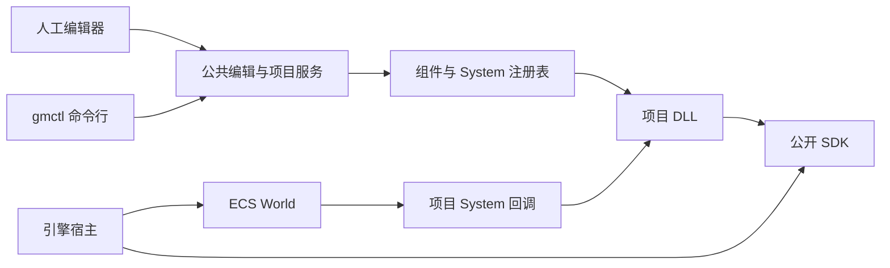

# 独立游戏项目、原生组件与 System（v0.7）

本版把游戏规则从引擎中移到独立 C++ 项目。项目只依赖 `sdk/include/gm/game.hpp`，编译成自己的原生模块；编辑器、命令行和 Player 使用同一套注册信息。添加项目组件或 System 不需要修改、重新编译引擎。

当前可用链路是 Windows x64 / C++20 / MSVC / CMake。这里的“脚本”是项目里的原生 C++ 游戏逻辑，不是尚未实现的 Lua、C# 或 JavaScript VM。移动端的链接、打包与脚本部署不在本版范围内。

## 1. 项目与引擎的边界

迁移后的示例位于 `../GMEngineGame/CrystalMeadow`，可以复制到引擎之外。旧源资源保留在 `../GMEngineGame/UIExamples/assets/scenes`；示例脚本位于 `../GMEngineGame/scripts`。引擎默认构建不依赖这个外部工作区。

```text
CrystalMeadow/
  game.gmproject                 项目清单
  CMakeLists.txt                 独立模块构建
  Scripts/
    components.hpp              游戏组件的数据定义
    game.cpp                    注册表、校验规则、System 实现
  assets/
    scenes/health-demo.scene.json
    ui/health-hud.ui.json
    images/...
  build/                        生成物，不作为游戏源码
    Release/CrystalMeadow.dll
    native-build.log
    game.gmscene
  dist/                         发布生成物
    gm_player.exe
    game.dll
    game.gmscene
    licenses/...
```

清单示例：

```json
{
  "format": "gm.project",
  "version": 1,
  "name": "CrystalMeadow",
  "entry": "assets/scenes/health-demo.scene.json",
  "module": "build/Release/CrystalMeadow.dll"
}
```

`entry` 和 `module` 相对项目根目录，不能越出根目录。资源内的图片和 HUD 路径相对该资源文件。清单可用文本编辑器修改；当前图形编辑器的项目页显示信息，尚没有清单属性编辑器。

| 层 | 负责什么 | 不能依赖什么 |
| --- | --- | --- |
| SDK | 数据描述、类型标识、批量查询、帧上下文、生命周期回调 | 引擎实现、Flecs、JSON |
| 引擎运行时 | 世界、基础变换和速度积分、System 调度、渲染、通用 UI 绑定 | `Health` 等具体游戏类型 |
| 项目模块 | 生命、输入规则、伤害、恢复、游戏规则和状态 | `src/` 私有头文件、编辑器对象 |
| 编辑服务 | 源资源校验、组件修改、撤销、编译、项目构建 | 具体游戏类型的硬编码字段 |
| GUI / CLI | 将人或自动化的操作转成命令 | 各自维护另一套组件模型 |



本版注册表在每个进程中对应一个活动项目；同一编辑器支持多个资源标签，不同时加载多个项目模块。切换项目时会释放旧文档，必须先保存并停止运行。

## 2. 继承、组合与脚本的关系

**Entity 用组合表达游戏对象。组件存数据，System 执行规则。** 场景中的父子关系表达空间层级，不是 C++ 继承关系，也不会自动把父实体的组件复制给子实体。

例如 Player 由 `Transform2D + Velocity + SpriteRenderer + Health + PlayerController + HealthRegen` 组成。敌人可以复用 `Health`、渲染和运动数据，添加自己的 `AIController`，由另一套 System 写入相同的 `Velocity`。不需要 `Enemy : Player : GameObject`。

组件声明的 `requiresTypes` 是“同时需要拥有哪些组件”：添加 `PlayerController` 会补齐 `Velocity` 和 `Transform2D`。它不表示继承、内存嵌套或 System 的执行顺序。缺失依赖、循环依赖、重复组件都会被拒绝。

| 需求 | 建议实现 |
| --- | --- |
| 多种角色共享生命、移动、背包数据 | 独立组件，按需要组合 |
| 同一套伤害算法复用 | 项目普通函数或算法库，供多个 System 调用 |
| 不同寻路策略、平台服务实现 | 可以在项目内部使用接口继承；由 System 的私有状态持有 |
| 每个世界一份缓存、计数器、服务对象 | System 的 `create / destroy` 状态 |
| 每个实体一份可编辑、可保存状态 | 组件字段 |
| 可复用实体配方、组件默认值覆盖 | 未来 Prefab / 模板层；不以 C++ Entity 继承代替 |

组件要求标准布局、可平凡复制。不要使用虚函数、拥有资源的指针、`std::string/vector` 或多层继承作为跨模块组件数据；当前支持的可序列化字段都是 32 位 `float`、`int32_t`、`uint32_t` 布尔、颜色和图片索引。字段描述中的偏移映射到运行时结构，编辑器无需理解 C++ 成员访问。

项目内部可以使用完整 C++，包括普通类、继承、模板和容器。它们留在算法层或 System 私有状态中；不能把这类对象的内存直接存入场景文件。

## 3. 如何扩展组件与 System

最小模板已经包含 `game.Mover`，可直接复制学习：`sdk/templates/Basic/Scripts/game.cpp`。实际示例提供了 float、int、bool 和跨字段校验。

```cpp
struct HealthRegen {
    static constexpr const char* gm_name = "HealthRegen";
    float perSecond = 0;
    uint32_t enabled = 1; // SDK 布尔字段用 32 位存储
    int32_t ticks = 0;
};

const gm::sdk::Field regenFields[] = {
    GM_FLOAT(HealthRegen, perSecond, "每秒恢复", 0, 0, 10000),
    GM_BOOL(HealthRegen, enabled, "启用恢复", 1),
    GM_INT(HealthRegen, ticks, "运行帧数", 0, 0, 2147483647)
};
```

通过 `component<T>(...)` 加入模块的 Component 数组，声明标签、字段、依赖、可选校验器及版本。注册表默认值用于“添加组件”和资源初始值，运行时从编译资源填充结构，不调用组件的自定义构造函数；C++ 成员默认值应与注册信息保持一致。

System 用有名字的更新回调注册，可以不带状态，也可以提供配对的 `create/destroy`：

```cpp
void regenerate(void*, const gm::sdk::Context* ctx) {
    ctx->each<Health, HealthRegen>([&](gm::sdk::Entity, Health& h, HealthRegen& r) {
        if (r.ticks < INT32_MAX) ++r.ticks;
        if (r.enabled && h.current > 0)
            h.current = std::min(h.maximum, h.current + r.perSecond * ctx->frame->dt);
    });
}
```

`each<const T, U>` 以只读 T、可写 U 查询，宿主缓存查询并向 DLL 提供批量数组。内层遍历直接访问本地类型；没有每个实体一次的虚拟 `Update()`。`get<T>(entity)` / `getMut<T>(entity)` 适合偶尔访问可选组件，密集处理优先放入查询参数。

模块导出唯一入口 `gm_game_module(hostAbi)`，返回 `Module` 描述表。描述表、名称字符串、回调都必须在模块加载期间有效。`gm.` 名称空间保留给引擎；项目建议使用 `game.` 或项目专属前缀。资源里的组件名稳定，改名需要同时迁移资源。

注册信息会直接用于组件菜单、检查器、命令 `describe`、源文件验证、二进制编译及加载，不需要另写编辑器面板。当前仍需手动编写 C++ 元数据，不扫描 C++ 源码自动推断字段。

## 4. System 调度与生命周期

每帧顺序固定为：

```text
Input → Simulation → 引擎计算世界变换 → PostTransform → Late → 提取渲染数据 / 更新 HUD
```

`after` 声明命名 System 的先后关系，支持同阶段拓扑排序，拒绝环和依赖未来阶段。未声明先后关系时，顺序采用注册表顺序；需要保证次序的规则应显式写 `after`。`after` 只是排序约束，不代表“只有前置 System 启用时才允许启用”。

当前内置 `gm.IntegrateVelocity` 位于 Simulation；项目中的边界限制在它之后。伤害与恢复在 PostTransform；恢复在伤害之后。变换写入应在 Input/Simulation 完成，PostTransform/Late 读取 `WorldPosition`。后两个阶段修改局部变换要到下一帧才参与世界变换计算。

生命周期：

1. 加载项目模块，检查 ABI、字段布局、依赖和 System 顺序。
2. 创建 World，注册原生组件，加载实体数据，计算初始世界变换。
3. 对场景中启用的 System 顺序调用 `create`。
4. 每帧按阶段调用 `update`。
5. Stop/reset 时逆序调用 `destroy`，销毁缓存查询与 World。
6. 最后一个拥有者释放注册表后才能卸载 DLL。

System 状态由项目 `create` 分配、同一模块的 `destroy` 释放，可在内部持有容器和普通 C++ 对象。不要以模块静态变量保存某个 World 的游戏状态；多个 World 可能同时使用同一模块。示例 `RegenState` 演示每个 World 独立分配。

当前 System 单线程串行执行，每帧回调一次。未实现并行任务图、每个 System 独立频率、运行时实体增删 API、事件总线或脚本调试器。编辑时添加/删除组件后重新运行已支持。

## 5. 模块 ABI、所有权与重载

原生入口使用 C 链接，边界传递固定宽度字段、指针、函数指针及描述表，不跨 DLL 传递 STL 所有权。`Context` 是 SDK 的轻量 C++ 包装；它调用宿主表里的函数。双方使用同架构、兼容的 C++ 工具链与运行库构建；这不是跨任意编译器、跨架构的通用二进制协议。当前 SDK ABI 为 7。

组件引用、数组指针和 `Context` 只在对应回调期间使用，不缓存到异步线程。场景 Entity ID 是保存到资源中的稳定字符串；SDK `Entity` 是当前 World 的不透明运行时 ID，不能跨 World、Stop 或重载保存使用。项目回调不应向宿主抛出异常；原生模块是受信任代码，不提供故障隔离或沙箱。

编辑器从临时影子副本加载 DLL，原始构建输出不被锁住。构建/重载要求停止运行、保存所有标签；新注册表必须能够验证所有打开文档。成功后清除旧撤销记录，避免把旧字段结构重新写回新模块。失败保留旧注册表，供修复后重试。

这属于**停止后的模块重载**，不会保留运行世界、栈、指针或 System 状态。代码热替换与运行状态迁移尚未实现。

添加新组件/System 后构建项目即可发现；修改已有组件的字段名称、布局含义或默认规则时，应更新组件版本并显式迁移源资源。当前没有自动迁移器；不兼容资源会被明确拒绝。需迁移时，在停止状态通过文本编辑器更新源文件，再重新打开项目或用 CLI 构建，不能假定旧字段会自动保留或转换。

## 6. 源资源到运行时

场景源文件仍是 `gm.scene` v1 JSON，组件以类型名、版本和字段表示。System 启停保存在 `disabledSystems`，属于可撤销的场景配置。项目编译器输出 `.gmscene` **二进制 v2**。

二进制保存稳定类型 ID、组件版本、规范化 32 位字段序列、UI 与图片数据，以及注册表指纹。它不保存 C++ 填充字节、指针、Flecs ID。Player 加载后将字段映射进原生组件，再交给 ECS；这是加载期 materialization，不宣称零复制。

运行每帧不解析 JSON、不查字段名称、不做组件继承反射；缓存查询的键使用固定数组，精灵数据批量提取，绘制顺序变化时才重新排序。Inspector/CLI 查询产生 JSON 仅用于编辑和检查；Player 不链接 JSON、源资源编译器或图片解码器。

HUD 现在绑定任意数值组件字段，例如：

```json
{
  "node": "health_value",
  "entity": "f38c5f65-42b3-4a22-a75d-a574d3b45a03",
  "kind": "number.text",
  "component": "Health",
  "field": "current",
  "maximum": "maximum"
}
```

`number.bar` 驱动条宽；`number.change` 在点击时增减字段并执行范围/组件规则校验。UI 保持独立控件树，不强制成为 ECS Entity。绑定源配置可通过 JSON 或 `binding.set/remove` 操作；本版没有新增图形化绑定向导。

旧二进制 v1 必须从源资源重新编译。旧源中的 `health.text/bar/change` 需改为 `number.text/bar/change` 并补充 component/field/maximum；已迁移的 CrystalMeadow 项目包含正确格式。

## 7. 人工编辑流程

1. 运行 `../GMEngineGame/scripts/launch.ps1`，或通过“项目 → 打开游戏项目”选择 `.gmproject`。
2. “项目 → 新建游戏项目”生成独立基础模板，选择一个不存在的新目录。
3. 在层级中选中实体；检查器的组件页可添加、移除、修改项目组件。布尔字段显示开关，图片字段提供选择器；依赖与取值规则由公共命令层校验。
4. 检查器切换到 Systems 查看阶段、执行顺序与所属模块；开关控制当前场景的执行，支持 Ctrl+Z / Ctrl+Y / Ctrl+S。
5. 在自己的代码编辑器修改 `Scripts/`。编辑器“项目 → 打开原生脚本目录”可定位；随后停止、保存所有标签，再“构建项目模块与场景”。构建错误详情在 `build/native-build.log`。当前构建是同步操作，界面会暂时等待。
6. F5 运行当前场景，包括未保存的资源修改；F7 暂停、Shift+F7 单步、F8 停止。运行中 Inspector 显示实时值并禁止修改编辑源。
7. “项目 → 生成 Windows 运行包”输出到项目 `dist/`。它使用已构建模块，源码修改后应先构建。

项目页显示目录、入口、模块、组件/System 数量及构建/打包入口。保存、撤销继续放在菜单和快捷键，不增加 Agent 面板。

## 8. 命令行流程

以下命令在引擎根目录执行。PowerShell 7 使用 UTF-8 管道，或使用 `--request` 传 JSON 文件。

```powershell
# 默认示例：构建、运行、发布
../GMEngineGame/scripts/run-scene.ps1
../GMEngineGame/scripts/package-scene.ps1

# 创建独立项目（目录必须不存在）
'{"op":"project.create","directory":"D:/Games/MyGame","name":"MyGame"}' |
  ../GMEngineSDK/bin/gmctl.exe --project ../GMEngineGame/CrystalMeadow/game.gmproject

# 自己的项目构建 / 查询
'{"op":"project.build"}' | ../GMEngineSDK/bin/gmctl.exe --project D:/Games/MyGame/game.gmproject
'{"op":"describe"}' | ../GMEngineSDK/bin/gmctl.exe --project D:/Games/MyGame/game.gmproject

# 仅依赖 SDK 的独立 CMake 构建，不参与引擎构建
cmake -S D:/Games/MyGame -B D:/Games/MyGame/build -G "Visual Studio 17 2022" -A x64 -DGMEngine_DIR=D:/Demo/GMEngineSDK/sdk/cmake
cmake --build D:/Games/MyGame/build --config Release
```

同一个 `--stdio` 进程保存编辑、撤销和运行世界：

```powershell
@'
{"op":"component.set","id":"f38c5f65-42b3-4a22-a75d-a574d3b45a03","type":"HealthRegen","field":"perSecond","value":5}
{"op":"system.list"}
{"op":"preview.run"}
{"op":"runtime.step","frames":10,"x":1,"y":0}
{"op":"runtime.query"}
{"op":"preview.stop"}
{"op":"undo"}
'@ | ../GMEngineSDK/bin/gmctl.exe --project ../GMEngineGame/CrystalMeadow/game.gmproject --stdio
```

离线 `preview.run` 初始化为暂停，用 `runtime.step` 明确推进固定 1/60 秒；没有图形窗口或后台实时循环。编辑器运行默认按真实时间推进，可传 `{"op":"preview.run","paused":true}` 创建确定性的暂停世界后按相同步骤验证。

`runtime.query` 返回每个实体的所有注册组件字段和 HUD 状态；不再使用仅对示例生效的顶层 `health` 字段。编辑状态修改只有在同一进程执行 `save` 才写盘。

编辑器与命令行协作：

```powershell
'{"op":"system.set","name":"meadow.Regeneration","enabled":false}' |
  ../GMEngineSDK/bin/gmctl.exe --live ../GMEngineGame/.gmengine/session
```

`project.open/query/create/build/reload/package`、`component.*`、`system.list/set`、`preview.*` 和 `runtime.*` 均有无窗口实现或实时对应入口。GUI 菜单/属性面板通过相同编辑服务执行；文件对话框、面板选择等纯界面操作只存在于 GUI。CLI 的 `project.build` 可在上次 DLL 无效时先编译修复源码，再加载模块。

## 9. 已验证与明确边界

引擎验证报告写入 `../GMEngineBuild/build/`，游戏验证写入游戏工作区的 `build/`：

- `ctest`：场景、编辑命令、UI 运行时、图片、渲染五套测试。
- `project-verification.json`：引擎之外的中文/空格路径项目，SDK 独立构建，新增 `game.Clock` 组件/System，命名空间字段编辑，System 开关，循环依赖拒绝及恢复，二进制发布和模块指纹不匹配拒绝；并校验引擎三个 exe 哈希未变化。
- `../../GMEngineGame/build/scene-live-verification.json`：真实编辑器进程中的注册、组件编辑、撤销、暂停单步、生命 HUD、源/运行隔离、构建重载和检查器切换。
- `runtime-deployment-verification.json`：Player 不链接编辑依赖，二进制资源可独立部署，拒绝损坏数据与 JSON。

发布目前打包清单的单个入口场景，图片和 HUD 内嵌其中；不提供多场景跳转、流式加载、Prefab、移动端包、插件依赖部署、脚本调试或状态保留热重载。Windows 运行包仍依赖对应 Visual C++ 运行库。后续扩展应沿 SDK、组件组合、System 调度和资源版本迁移继续推进。
