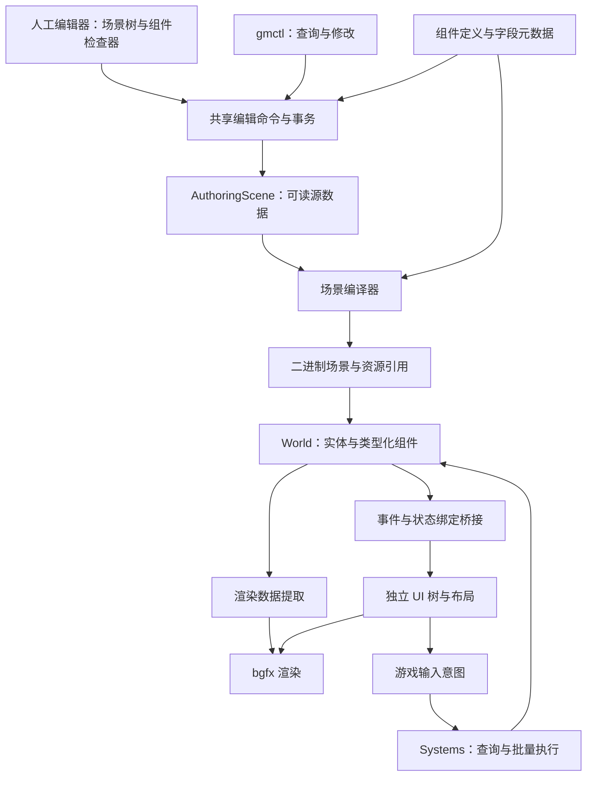

# 主流引擎 ECS 调研与 GMEngine 架构方案

调查日期：2026-10-29。本文保留最初设计提案。后续已完成 Flecs／EnTT 对照、Flecs 接入及场景示例，实际实现范围和测量结果见 [v0.6 接入报告](../ecs-validation-v06.md)；本提案中的后续能力不代表全部已经实现。

**建议：场景与游戏逻辑从底层采用 ECS；编辑器用熟悉的 Entity／Component 检查器呈现；UI 保持独立。底层首先评估 Flecs 4.1.6，用 EnTT 4.0.0 做同负载对照，暂不自研 ECS 存储器。** 选择依据是当前需求的契合程度，并非已经测得 Flecs 比其他方案更快。

本方案延续已确定的 C++20、bgfx、Windows／Android／iOS 优先，以及编辑源文件可读、发布时使用高效二进制的方向。Web、macOS 保留适配路径。编辑器服务开发者，命令行服务自动化；两者使用同一套编辑能力。

## 1. 先明确我们要的 ECS

“对象上可以挂组件”是一种编辑与组合方式，不足以说明运行时采用高性能 ECS。

- **Entity**：有生命周期的身份，可以理解为对象编号，不自带庞大的对象基类。
- **Component**：实体的数据，例如位置、速度、生命值和图片资源句柄。
- **System**：查询满足条件的实体，成批处理组件数据，例如对全部具有位置和速度的实体执行移动。

检查器可以将组件展示成卡片，运行时却按组件类型或组件组合组织内存。二者并不矛盾。函数也不必从所有类型中消失；关键是避免让每个实体都依赖一串堆对象、字符串查询和虚函数回调来执行主要逻辑。

UI 树需要布局、裁剪、焦点、事件传播和绘制次序。它可以单独实现，不要求每个按钮、文本或图片成为 ECS Entity。当前已有的 UI 二进制、布局缓存和图片处理继续使用。

## 2. 其他引擎实际采用了什么

以下是架构比较，不是 FPS 或内存排名。本次查阅官方文档与版本源码，没有在这些引擎中执行统一性能测试。

| 引擎 | ECS 支持与实现 | 对 GMEngine 的启示 |
| --- | --- | --- |
| Unity Entities | 在传统 GameObject 工作流之外提供数据导向 ECS；相同组件组合形成 Archetype，数据按类型放入 Chunk | 借鉴编辑表示到运行表示的烘焙，以及批量处理；不必为新引擎同时建立两套完整游戏对象体系 |
| Unreal Mass | Entity 由 Fragment 数据组成；按 Archetype／Chunk 组织，Processor 批量执行；与 Actor 等原有体系协作 | 借鉴数据与行为分离、延迟结构修改、配置资产；不要把 Mass 理解为所有 Unreal 对象的统一底层 |
| Godot | 官方主要工作流是 Node、Scene、Resource；高负载任务可以直接访问底层 Server | 借鉴清楚的层级编辑与资源组织；Node 工作流本身不等同于 Archetype ECS |
| Bevy | ECS 是引擎的基础；组件支持 Table 和 SparseSet 存储；系统声明数据访问，调度器据此安排执行 | 最接近“从根源支持 ECS”的架构目标；借鉴运行模型，不因此将 C++ 核心改成 Rust |
| O3DE | 提供实体组件工作流、反射、编辑器组件到运行组件的构建接口 | 重点借鉴组件检查器、字段元数据和编辑／运行分离；不能仅凭 Entity／Component 命名认定它采用相同的连续批处理存储 |

### Unity：编辑体验与运行效率可以分别设计

Entities 1.4.2 文档说明：一个 Archetype 对应一种组件组合，Chunk 为 16 KiB，内部包含各组件类型的数组。添加／移除组件可能使实体迁移到另一 Archetype。该固定 Chunk 大小属于 Unity 实现，不是 ECS 的通用要求。[Archetype 与 Chunk](https://docs.unity.cn/Packages/com.unity.entities@1.4/manual/concepts-archetypes.html)

Unity 通过 Baking 将 GameObject 作者数据转换为运行时 Entity 数据，转换不要求一一对应，也不是把运行状态自动还原为源场景。GMEngine 可以借鉴这种边界：人看到易编辑的组件，编译器决定高效的运行表示。[Baking](https://docs.unity.cn/Packages/com.unity.entities@1.4/manual/baking-overview.html)

批量结构修改与同步点同样重要。把逐个实体的增删组件集中到命令缓冲中处理，可以控制修改时机，但不能消除迁移本身的开销。[Entity Command Buffer](https://docs.unity.cn/Packages/com.unity.entities@1.4/manual/systems-entity-command-buffers.html)

### Unreal：Mass 是数据导向子系统，并有对象桥接

Mass 使用 Fragment 存数据，Processor 查询和处理实体集合，并通过 MassCommandBuffer 延迟结构修改；Traits 和 Entity Config 负责配置实体组成。MassGameplay 又提供 Actor、实例化网格等表现方式。这说明批量模拟和复杂对象表现可以有明确边界。[MassEntity](https://dev.epicgames.com/documentation/en-us/unreal-engine/overview-of-mass-entity-in-unreal-engine)、[MassGameplay](https://dev.epicgames.com/documentation/unreal-engine/overview-of-mass-gameplay-in-unreal-engine?lang=en-US)

对 GMEngine，最有价值的是“数据、处理、表现”分工。暂时没有必要引入一套类似 Actor 的完整旧对象运行时，再增加另一套 ECS 运行时互相同步。

### Godot：树形作者模型有价值，但不是我们的存储方案

Godot 的官方核心概念是由 Node 组成 Scene，并通过 Resource、Signal 等机制组织内容。其性能文档允许在适合的场景直接操作 RenderingServer、PhysicsServer 等接口及 RID，减少对场景节点的依赖。本次调查没有在这些官方主工作流资料中发现等同于 Entities／Mass 的内置通用 ECS；这不排除第三方扩展。[核心概念](https://docs.godotengine.org/en/stable/getting_started/introduction/key_concepts_overview.html)、[直接使用 Server](https://docs.godotengine.org/en/stable/tutorials/performance/using_servers.html)

我们可以保留清晰的场景树，同时让树只表达父子关系；树中的每一项不必对应一个承载全部行为的 C++ 对象。

### Bevy：原生 ECS 和明确的数据访问约束

Bevy 将应用逻辑建立在 ECS 上。其存储支持默认的 Table，以及具有不同增删／遍历权衡的 SparseSet；这不是“所有组件必须采用一种存储”的设计。[Bevy ECS 0.19.1](https://docs.rs/bevy_ecs/0.19.1/bevy_ecs/)

系统通过参数声明访问的数据，调度器可以并行执行兼容的系统；业务上的先后依赖仍需明确指定，不能把“没有数据竞争”误认为“执行次序一定正确”。[System 调度与顺序](https://docs.rs/bevy/latest/bevy/ecs/system/)

GMEngine 应借鉴访问声明和执行阶段。第一版优先得到正确、可预测的顺序，再逐步并行化，不应一开始承诺与 Bevy 相同的完整调度能力。

### O3DE：组件检查器与运行组件的边界

O3DE 的组件通过反射暴露序列化、编辑和脚本信息；Editor Component 可以使用 BuildGameEntity 创建运行组件。其 AZ::Component 生命周期包含 Init、Activate、Deactivate。这些机制适合参考作者工具设计，但与 Archetype／SoA 的存储选择是不同问题。[组件创建](https://www.docs.o3de.org/docs/user-guide/programming/components/create-component/)、[Editor Components](https://docs.o3de.org/docs/user-guide/programming/components/editor-components/)

GMEngine 的组件注册也应一次定义字段及编辑规则，同时服务检查器、命令行和编译器，避免三套字段定义各自演化。

## 3. C++ 底层选型：Flecs 优先，EnTT 对照

Flecs 和 EnTT 是可嵌入的库，不是自带完整编辑器、资产管线和游戏框架的引擎。

| 方案 | 存储与能力 | 需要自己补齐的部分 | 本项目判断 |
| --- | --- | --- | --- |
| Flecs 4.1.6 | Archetype／SoA 表、查询与缓存、关系、系统及执行管线；C 核心，提供 C++ API | GM 的作者格式、检查器、编译器、脚本策略、资源生命周期与性能约束 | 首选验证，较符合原生 ECS 场景和批量处理需求 |
| EnTT 4.0.0 | 以 Sparse Set 组件池为基础，提供 View／Group、元信息及 Organizer 等工具；header-only，要求 C++20 | 引擎级层级规则、任务执行、编辑管线等整合工作 | 可信对照方案；结构修改、随机访问等负载下值得实测 |
| 自研存储与查询 | 可完全控制布局、分配器和接口 | 还须处理生命周期、查询缓存、迭代失效、结构修改、调度及调试工具 | 当前不采用；只有成熟库出现明确、可复现的约束时再评估 |

依据：[Flecs 文档](https://www.flecs.dev/flecs/)、[Flecs 4.1.6](https://github.com/SanderMertens/flecs/releases/tag/v4.1.6)、[EnTT 4.0.0 说明](https://github.com/skypjack/entt/blob/v4.0.0/README.md)、[EnTT 实体模块](https://github.com/skypjack/entt/blob/v4.0.0/docs/md/entity.md)。版本用于固定第一轮评估，不表示所有滚动文档内容都能直接用于其他版本。

选择 Flecs 的理由是它已经提供了本项目需要的一组 ECS 基础机制，能把研发投入集中在场景、编辑体验和资源编译上。**不是因为 Archetype 在所有场景都比 Sparse Set 快。** 组合种类多、结构频繁变化、随机查找多时，结果可能不同；EnTT 的 View／Group 优化也需要公平使用。

两项特别容易误解的能力：

1. Flecs 的缓存查询减少重复匹配工作，但会增加创建、内存与表变化维护成本。稳定逐帧 System 使用持久查询；一次性的检查器查询不应无条件永久缓存。[Queries](https://www.flecs.dev/flecs/Queries.html)
2. Flecs 的内置多线程主要将**一个 System 的迭代工作**分给多个线程，不能直接视为 Bevy 式不同 System 的自动并行执行；EnTT Organizer 生成依赖信息，本身也不是任务执行器。GM 第一版采用显式阶段，随后对合适的批次并行。[Flecs Systems](https://www.flecs.dev/flecs/Systems.html)、[EnTT Organizer](https://github.com/skypjack/entt/blob/v4.0.0/docs/md/entity.md#organizer)

GM 的资源格式、稳定标识和编辑协议不直接暴露 Flecs 内部类型编号。性能敏感的 System 则保留类型化、可内联的查询，不为了“随时替换库”引入逐实体虚函数或字符串分发层。更换底层库仍有移植成本，不能承诺零成本替换。

## 4. GMEngine 的整体结构



### 4.1 一个编辑对象，运行时不需要一个厚重对象

在检查器中，开发者看到的可以是：

```text
Player
  Transform2D
    Position: 100, 200
    Rotation: 0
  SpriteRenderer
    Image: player.png
    Tint: white
  Health
    Current: 100
    Maximum: 100
  PlayerController
    Speed: 5
  [添加组件]
```

其中 PlayerController 可以作为可挂载的行为配置显示。执行代码由对应 System／行为执行器管理；它不是要求每个 Entity 都有一个独立的 Update 虚函数。

编辑表示允许组合得更适合人。初期作者组件和运行组件基本一一对应，后续可以把一个作者组件编译成多个运行组件，或把公共数据编译为共享资源。不要提前建立复杂的通用烘焙插件框架。

### 4.2 场景、World、身份与生命周期

| 概念 | 建议职责 |
| --- | --- |
| AuthoringScene | 源资源、稳定实体 ID、字段值、引用；是编辑状态的权威来源 |
| Scene 运行实例 | 一次场景加载产生的实体集合与资源持有关系；用于卸载和引用检查 |
| World | 实体、组件、查询与模拟上下文；一个 World 可加载多个 Scene |
| Entity ID | 源数据使用稳定 UUID；运行时映射为带代数的句柄，避免误用已销毁实体 |
| 组件类型和字段 ID | 由 GM 元数据显式定义、跨构建稳定；不能直接保存库内部注册顺序或内存偏移 |
| 资源引用 | 通过资源 ID／句柄访问纹理、网格、音频等；组件不复制实际资源负载 |

编辑预览与 Play 使用隔离的 World。运行中的生命值、生成对象和脚本状态不自动写回场景源文件。不同 World 的句柄不能互用；持久引用也不能保存裸指针或数组行号。第一版明确处理同场景引用及失效引用，跨场景引用和异步加载作为后续扩展。

### 4.3 源文件可读，运行时类型化

以下是拟议格式，仅展示组成，不是当前工具已经支持的输入：

```json
{
  "format": "gm.scene",
  "version": 1,
  "entities": [
    {
      "id": "cfe491f1-e9d5-4b54-911b-e986bb99e263",
      "name": "Player",
      "parent": null,
      "components": [
        {"type": "gm.Transform2D", "version": 1, "fields": {"position": [100, 200], "rotation": 0, "scale": [1, 1]}},
        {"type": "gm.SpriteRenderer", "version": 1, "fields": {"image": "asset:9e76c854-844e-42ca-b886-72990019b2eb"}},
        {"type": "game.Health", "version": 1, "fields": {"current": 100, "maximum": 100}},
        {"type": "game.PlayerController", "version": 1, "fields": {"speed": 5}}
      ]
    }
  ]
}
```

类型名称用于阅读和查找，由注册表映射至稳定类型 ID；重命名须保留 ID 并提供旧名称迁移。路径变化不改变图片资源身份。第一版同一实体上的同类型组件最多一个；确实需要多实例时使用显式列表或不同实体，不隐式覆盖。

编译流程：解析和校验源数据 → 迁移字段版本 → 检查组件依赖和引用 → 剥离编辑专用信息 → 组织组件数据块、资源表及引用修复表 → 写入二进制。加载时批量创建所需实体组合，再填充数据和解析引用。

二进制应定义格式版本、字节序、字段编码、对齐与边界检查，**不能直接把 C++ struct、std::string、指针或 Flecs 内存布局写到文件中**。运行时可能仍需要分配 ECS 存储和修复句柄；二进制不自动意味着零拷贝加载。发布 Player 不链接 JSON 编辑器与场景编译器。

### 4.4 一套组件元数据支持手动与命令行

组件在 C++ 中注册类型、字段、默认值、显示名称、取值约束、资源引用类型、版本迁移，以及必要的组件依赖／互斥规则。普通 C++ 注册表或代码生成即可，不依赖尚未接入的语言反射功能。

由同一份定义提供：检查器控件、CLI 查询结果、字段校验、源文件读写、编译转换和后续脚本绑定。字段标记区分可编辑、仅运行时、仅编辑时和可持久化状态。调度期间的热循环直接访问类型化数据，不做逐字段反射解释。

拟议编辑命令包括 entity.create／delete／duplicate／reparent，以及 component.add／remove／set／query。具体名称在扩展 gmctl 时固定；这些名称当前不是可运行命令。

人工拖动、输入属性和 CLI 修改都经过同一事务服务，统一校验、撤销、版本冲突和保存。场景变大后，撤销记录保存字段差量或必要的子树快照，设定内存预算，不为每次修改复制整个场景。撤销是编辑事务；游戏运行时的普通数值更新不走编辑事务。

## 5. 容易损失 ECS 收益的四个地方

### 5.1 父子层级：不要让每个父对象都制造大量小表

Flecs 的 ChildOf 关系和 Parent 组件有不同的存储权衡。ChildOf 的目标参与表区分，很多父对象且每个只有少量子对象时可能造成碎片；Parent 让同类实体可以存储不同父值，但仍有按深度分组等规则，向上查询也有不同成本。v4.1.6 的头文件已经包含 EcsParent，并非只在未来版本规划中。[Hierarchies Manual](https://www.flecs.dev/flecs/HierarchiesManual.html)、[4.1.6 固定版本头文件](https://raw.githubusercontent.com/SanderMertens/flecs/v4.1.6/include/flecs.h)

建议先用 Parent 路线验证普通场景层级，明确子项顺序、重设父级、禁止循环、删除语义，以及保持局部／世界变换的选择。Transform System 按父先子后顺序计算，使用明确的变更标记；不让每个实体每帧重新向上遍历整条祖先链。对静态少数层级与大量动态父对象分别测量，必要时使用独立的层级索引缓存。

显示名称、图片 ID、追踪目标和经常变化的数值默认作为字段，不因为关系 API 方便就全部做成影响 Archetype 的标签或目标组合。

### 5.2 脚本：挂载方便与执行高效分别保证

脚本在检查器中像组件一样添加、配置和禁用，符合用户需求。内部建议分开处理：

- 配置及可批量处理的状态放在类型化组件中；代码由脚本类型或行为定义标识。
- 移动、战斗数值、成批动画参数等高频工作优先交给 C++ System。
- 脚本优先响应事件，需要逐帧执行时显式订阅；提供批量查询／批量操作入口，避免每实体跨语言调用多次字符串版 GetComponent。
- 必须使用 VM 对象的行为，把实例放入独立池，由组件保存句柄，明确销毁和重载规则。这样有利于管理，但并不会使 VM 对象自动获得连续数据的性能。

第一版用可挂载的 C++ 行为完成工作流，脚本语言选择单独评估。C++ 行为不是已经实现了动态脚本。后续脚本方案不以 JIT 或动态库热替换作为发布运行时的必需条件，为移动端和 Web 留出解释执行或预编译路径。

### 5.3 结构变化与调度：先规定正确的修改时机

“修改已有组件数值”和“创建／销毁实体、增删组件”分开处理。前者可在获得相应写权限的 System 内直接执行；后者进入运行时结构命令缓冲，在明确同步点合并，不能在遍历中任意使指针失效。普通状态切换优先用字段或适合的启用机制，避免高频来回改变组件组合。

初期执行顺序可以是：输入快照 → 游戏逻辑／行为 → 移动或物理步进 → 世界变换更新 → 渲染数据提取。物理是预留阶段，不表示目前已有物理引擎。固定模拟步长与渲染插值以后按实际游戏需求接入。

System 声明读写组件及外部资源，并显式声明业务先后关系。先单线程验证，再并行较大的独立批次；小任务不一定值得线程调度开销。工作线程的结构命令按稳定批次顺序合并；这有助于复现，但不等于跨平台浮点模拟天然确定。

裸指针写入不会自动告诉引擎哪个字段变了。Transform、UI 绑定等依赖变更的地方，应使用受控写入口或显式标记。不能声称所有直接 C++ 写操作都能免费被追踪。

### 5.4 渲染与 UI：通过小而清楚的接口连接

渲染提取阶段从完成模拟的 World 读取变换和渲染组件，生成可排序、可批处理的绘制数据，再交给 bgfx。需要并行消费时使用只读快照和明确的资源生命周期，不能让渲染线程随意读取正在结构修改的 World。

UI 继续拥有自己的控件树、布局与绘制顺序。桥接层将生命值等变化推送到指定 UI 字段；按钮产生游戏输入意图，在确定阶段交给游戏逻辑。大量绑定采用变更通知或版本检查，不逐帧反射扫描所有 Entity 和所有 UI 字段。

一个世界空间血条可以由实体的 Health、Transform 驱动独立 UI 实例；它不要求将血条内部每个图像和文字都变成实体。

## 6. 对当前仓库的具体改动边界

当前 `gm_runtime` 是类型化的 UI 节点数组与缓存，不是完整 ECS。`gm_core` 承载 JSON 作者文档，Player 已与它分离。应在此基础上增加场景模块，而不是把现有 UI 节点改名成 Entity。

| 现有／拟议模块 | 职责与依赖 |
| --- | --- |
| 现有 gm_runtime、gm_runtime_view | 保留独立 UI 二进制、布局、命中测试和绘制 |
| 现有 gm_renderer | 继续使用 bgfx；逐步增加场景渲染所需提交接口 |
| 拟议 gm_ecs | World、组件存储、查询和结构命令；不依赖 JSON、编辑器或窗口系统 |
| 拟议 gm_component_schema | 稳定类型／字段身份与注册；编辑描述与最小运行类型信息可分开构建 |
| 拟议 gm_scene | 二进制加载、实体引用、场景实例生命周期与基本 Systems |
| 拟议 gm_scene_authoring／gm_scene_compiler | 源场景、事务和编译；允许依赖 JSON，发布 Player 不链接 |
| 编辑器与 gmctl 扩展 | 共同调用场景作者服务；组件检查器复用元数据 |

初期这些职责可以集中在少量文件和库中，不必为每个名称马上创建独立项目。依赖方向和运行时边界比文件夹数量更重要。

当前窗口、文字和部分渲染接入仍是 Windows 实现。选用可移植的 ECS 库不会自动完成 Android、iOS、macOS、Web 的窗口、输入、字体或打包适配；应分别记录 ECS 核心验证和整机运行验证。

## 7. 实施顺序与验收

| 阶段 | 实际交付 | 验收条件 |
| --- | --- | --- |
| A：验证底层 | 固定 Flecs 与 EnTT 版本的独立测试程序、相同负载测量、平台编译检查 | 生命周期和查询结果正确；记录耗时／内存／结构修改峰值；根据结果保留 Flecs 或切换 EnTT |
| B：建立场景核心 | World、稳定 ID 映射、基本组件、场景编译与加载、headless 命令 | 不启动编辑器即可创建、查询、修改和编译场景；运行加载不依赖 JSON；失效引用及错误版本能报错 |
| C：接入人工编辑 | 场景树、组件检查器、增删组件、字段编辑、撤销、运行／停止 | 手动与 CLI 操作得到相同作者数据；编辑和 Play 隔离；UI 示例继续正常运行 |
| D：完成可玩闭环 | 移动图片实体、可挂载行为、生命值、独立 UI 绑定 | 检查器可配置行为；System 批量更新；UI 展示和按钮交互走桥接；记录整个示例的帧预算 |

第一个示例采用当前渲染基础较容易支持的 2D 场景：图片角色带 Transform2D、SpriteRenderer、Health 和 PlayerController，独立 UI 显示生命值。它验证场景架构，不代表引擎只支持 2D；3D Transform、网格、物理、复杂预制体覆盖和网络同步后续分别设计。

### 底层测量必须覆盖什么

| 负载 | 需要揭示的问题 |
| --- | --- |
| 1 千／1 万／10 万实体，位置＋速度稳定更新 | 基础迭代、查询建立与稳态成本 |
| 每帧约 1%／10% 实体增删组件或生成／销毁 | 迁移、分配、同步点、查询缓存维护和峰值 |
| 少量组合与大量不同组件组合 | 表／池元数据、占用率、碎片和查询成本 |
| 宽层级、深层级、很多不同父对象、频繁 reparent | 层级维护和世界变换开销 |
| 批量访问与随机实体查询 | 连续处理优势及随机查找代价 |
| 加载／卸载和多次运行／停止 | 峰值内存、资源释放、陈旧句柄与泄漏 |
| 单线程与适当数量工作线程；纯 C++ 与行为调用 | 并行收益、任务粒度、脚本边界开销 |
| 提取绘制数据，并更新少量 UI 绑定 | 整体集成成本，避免只报告一个空循环成绩 |

使用相同硬件、Release 优化、编译器设置、组件尺寸和有效计算；查询构建与稳态迭代分别计时，校验计算结果避免被优化掉。分别报告中位数、P95／P99、实际分配量、峰值内存和实体／表数量，公开原始数据与测试代码。用简单连续数组作为计算下限参考，但明确它没有完整 ECS 功能。

Windows x64 与至少一台 Android ARM64 真机应优先测量；iOS／macOS 需要相应工具链与设备，Web 验证单线程可用路径及包体。尚未具备的设备记录“未验证”，不以桌面数据替代移动端结论。

架构选型不会代替测量。若 Flecs 在代表性负载中出现不可接受的内存／帧时间峰值，先定位是否来自层级表达、碎片、脚本或同步策略，再与合理配置的 EnTT 比较；如果瓶颈和整合成本更适合后者，则在接入完整编辑器前切换。不要为一次合成测试的最高吞吐率牺牲实际场景表现。

## 8. 本次建议固定的边界

1. 场景与游戏逻辑使用原生 ECS，UI 保持独立；编辑器通过同一场景服务操作实体。
2. 用户面对 Unity 风格的组件检查器；运行时面对类型化数据和批量 System。
3. Flecs 为首选评估实现，EnTT 为对照；当前尚未完成性能验证或安装依赖。
4. 可读作者数据编译为稳定二进制，不序列化底层 ECS 的内部内存结构。
5. 先完成“场景—组件—行为—渲染—独立 UI”的小型闭环，再决定脚本语言和高级引擎功能。

资料版本范围：Unity Entities 1.4.2；Unreal 查询页面标注 5.8；Godot stable 文档；Bevy ECS 0.19.1；O3DE 当前用户文档；Flecs 4.1.6 固定源码与 v4.1 在线手册；EnTT 4.0.0 固定源码。本文的 GM 模块、格式、策略和阶段均为结合这些事实形成的设计建议，不是外部引擎已经替 GMEngine 实现的能力。
